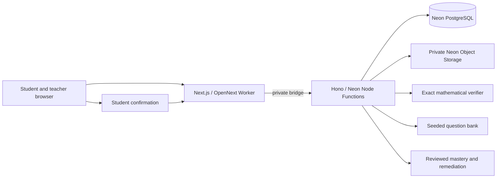

# System Architecture

The modular monolith is deployed at the official workers.dev origin. Next.js/OpenNext serves the UI on Cloudflare Workers. A fixed-origin private bridge forwards API calls to the existing Hono application on Neon Node Functions, preserving scrypt and Sharp. Neon PostgreSQL provides relational persistence; private Neon Object Storage holds normalized photographs. The server remains authoritative for permissions, transcription versions, grading and teacher reviews.

Pure packages own contracts, question generation, exact mathematics, recommendations and vision-output validation. Local Next.js/SQLite development remains supported. Experimental local OCR uses durable database jobs and a separate model service; hosted OCR is not activated. Classroom replay is persisted and deterministic; live subscriptions remain pending. TASK-0029 adds database-backed resource reservations before expensive requests, with production activation tracked in [[Current-State]].

See [[ADR-0006-Free-Cloud-Runtime]], [[ADR-0005-Async-Persistence]], [[Security-Engineering]] and [[Current-State]] for verified boundaries and release status.
